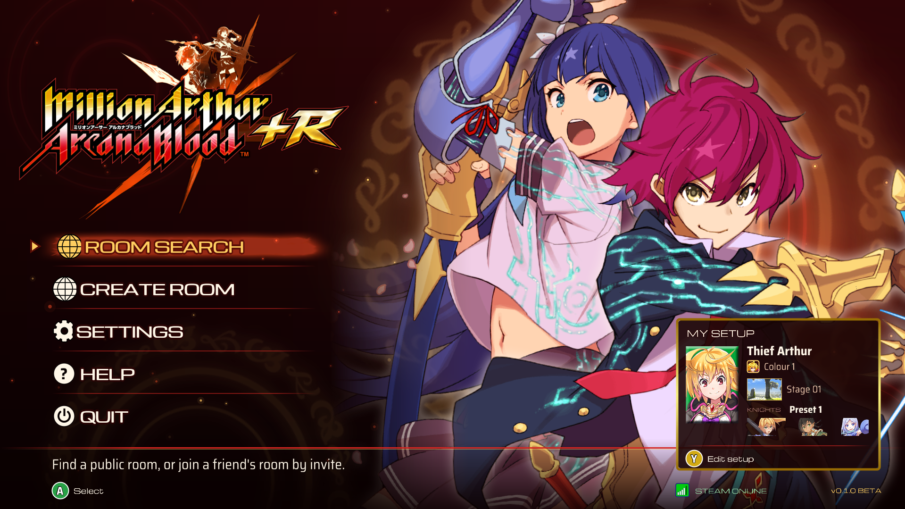
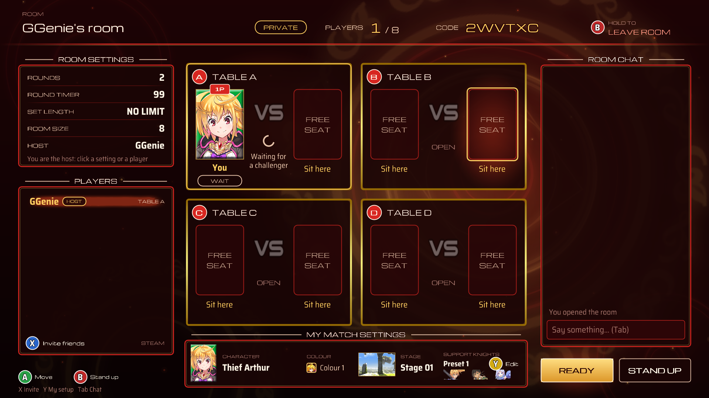
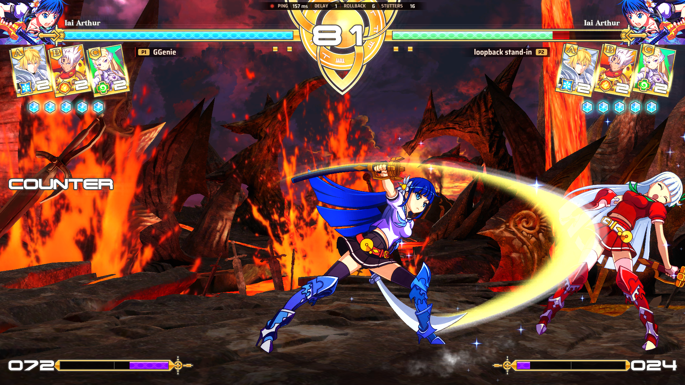
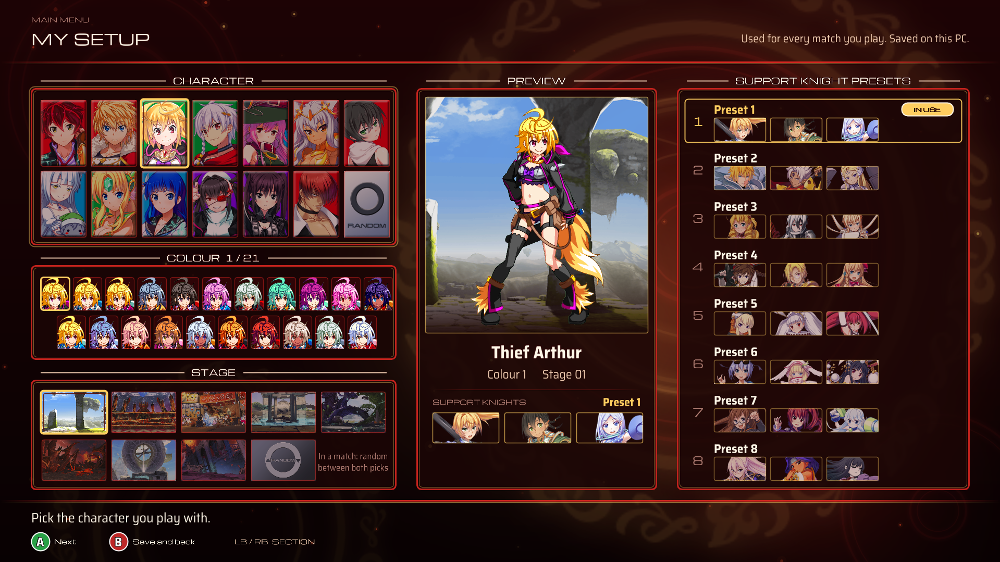
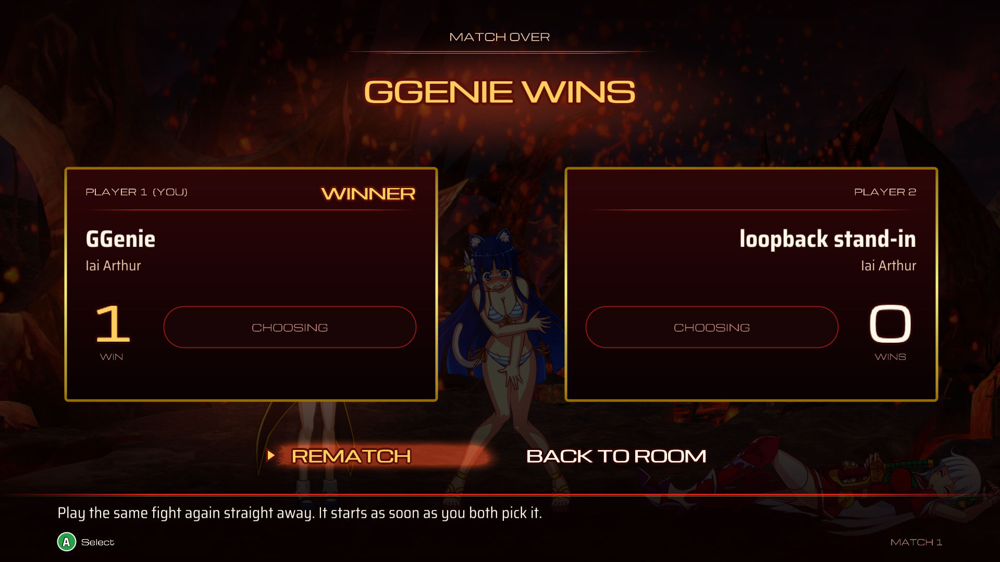

<p align="center">
  
</p>

<p align="center">
  <b>Rollback netcode and a new front end for Million Arthur: Arcana Blood on Steam.</b>
</p>

<p align="center">
  <a href="../../releases/latest"></a>
  
  
  
  <a href="LICENSE"></a>
</p>

<p align="center">
  <a href="https://robinneefs.github.io/million-arthur-arcana-blood-plus-r/"><b>Website</b></a> ·
  <a href="#-install">Install</a> ·
  <a href="#-playing-online">Playing online</a> ·
  <a href="#-troubleshooting">Troubleshooting</a> ·
  <a href="#-reporting-a-problem">Report a problem</a> ·
  <a href="CHANGELOG.md">Changelog</a>
</p>

---

**Arcana Blood +R** is a fan-made mod for the Steam version of Million Arthur: Arcana Blood. It replaces the game's online play with **rollback netcode**, so online matches feel close to playing side by side, and gives the game a new front end built around **rooms** where several pairs of players can play at the same time.

Start it with its launcher. The launcher keeps the mod up to date and starts the game with it. **No game file is changed**: the launcher only adds one small file, `dinput8.dll`, to the game's folder. That file does nothing unless the launcher started the game, so the game started from Steam stays the plain game.

<p align="center">
  
</p>

<table>
  <tr>
    <td width="50%"><br><sub><b>Rooms with tables.</b> Sit down, press READY, fight.</sub></td>
    <td width="50%"><br><sub><b>Rollback online fights</b> with a small info bar (ping, delay, rollback).</sub></td>
  </tr>
  <tr>
    <td width="50%"><br><sub><b>My setup.</b> Character, colour, Support Knights and stage, set once.</sub></td>
    <td width="50%"><br><sub><b>Instant rematch</b>, or back to the room.</sub></td>
  </tr>
</table>

## ✨ Features

- **Rollback netcode** over Steam: the game state is saved every frame and replayed when the other player's input arrives late. A desync check runs in the background.
- **Rooms**: create a public or private room (2-8 players), find public rooms in Room search, invite Steam friends, or share a private room's **code**. Rooms have tables: sit down, both press READY and the fight starts.
- **Room settings**: rounds, round timer, set length and room size, with text chat and host kick.
- **My setup**: pick your character, colour, Support Knights presets and stage once; every match starts straight away with them. No character select screens.
- **Instant rematch** without the versus and loading screens.
- **Settings**: remap controller and keyboard with a button check, sound volumes, display (resolution, display mode, borderless), input delay.
- **Connection handling**: a clear pop-up when the other player leaves or the connection drops, and a waiting banner on short hiccups.
- **Automatic updates**: the launcher checks for a new version at start and asks before installing it.
- **Pack logs**: one button collects the logs into a zip with names and Steam IDs hidden, for bug reports.

> [!IMPORTANT]
> **You need the official Steam version of Million Arthur: Arcana Blood.** The mod does not include the game or any part of it, and it only runs on the Steam version it was made for. It checks the game version at start-up and stays off if it doesn't match.

## 📦 Install

Download the newest version from the [**Releases page**](../../releases/latest). There are two ways to install, and they work the same:

<table>
  <tr>
    <th width="50%">🧩 Installer (easiest)</th>
    <th width="50%">🗂️ Zip (no install)</th>
  </tr>
  <tr valign="top">
    <td>

1. Download `ArcanaBlood-PlusR-v…-Setup.exe`.
2. Run it. It installs for your Windows user only (no admin rights needed), adds a Start menu shortcut and, if you want, a desktop shortcut.
3. Start **Arcana Blood +R** from the Start menu or the desktop.

To remove it: Windows Settings › Apps › Arcana Blood +R › Uninstall.

</td>
    <td>

1. Download `ArcanaBlood-PlusR-v….zip`.
2. Unzip it anywhere you like, **but not inside the game's folder**.
3. Start `arcana_launcher.exe` from that folder.

To remove it: delete the folder, and `dinput8.dll` from the game's folder.

</td>
  </tr>
</table>

Press **Play**. The launcher finds the game through Steam, makes sure its small `dinput8.dll` is in the game's folder (it puts it back by itself after a game reinstall), and starts the game with the mod. **Steam has to be running.** The game opens straight on the mod's main menu. Started from Steam directly, the game is the plain game; hold **Shift** while it starts to skip the mod once.

> [!NOTE]
> The first time, Windows may show **"Windows protected your PC"**, because the launcher and installer are not code-signed (signing costs a yearly fee). Click **More info › Run anyway**. If your antivirus removes a file of the mod, restore it and allow the mod's folder: it is a false alarm (please tell us in an issue). Nothing is injected into the game, and the updater only installs files whose checksum matches the release. The full source code is in this repository.

**Updating:** the launcher checks this repository's releases each time it starts. When there is a newer version it shows what's new, and one click installs it in a few seconds (the download's checksum is checked, and nothing changes if anything fails). Your settings and My setup are kept. You can also install a new version over the old one by hand, either way.

## 🎮 First steps

1. On the main menu, press **Y** (or click the My setup card) and pick your character, colour, Support Knights and stage. That is what you play with.
2. Check **Settings › Controls** for your buttons, and **Settings › Online** for the input delay.
3. **F1** (or Back + Start on a controller) opens and closes the main menu. The mouse works in all menus; right click goes back.

## 🌐 Playing online

1. **Create room** (public or private), or open **Room search** to join a public room.
   - Friends: invite them from the room with **X**; they accept on their main menu.
   - Private room: share the **CODE** shown at the top of the room. Your friend picks **Room search › X Join with code**.
2. **Sit at a table** (A on a free seat). Press **A on your own seat** to get READY.
3. When both players at a table are READY, the fight starts after a 3-2-1 countdown.
4. After the fight: **Rematch** or **Back to room**. If either player picks Back to room, both go back. **B** stands up, **hold B** to leave the room.

Both players need the same version of the mod; if they don't, the message tells who has to update.

## 🛠️ Troubleshooting

| Problem | What to do |
| --- | --- |
| "Could not find the game" | Make sure the game is installed through Steam and Steam is running. |
| "The game is already running" | Close the game first, then start the launcher again. |
| The game starts without the mod | Start it from the launcher (Play), not from Steam. |
| Windows or the antivirus warns about the mod | See the note under [Install](#-install): it is a false alarm. |
| "Another mod's dinput8.dll is in the game folder" | The launcher can set it aside as `dinput8.dll.before-plusr`; uninstalling puts it back. |
| The room list is empty | Only rooms of the same mod version are shown. Create a room, or ask your friend for an invite or the room code. |
| "That room uses a newer/older version" | Whoever has the older version: close the game and start the launcher; it offers the update. |
| Choppy online play | Raise the input delay in Settings › Online by 1. A wired connection helps more than anything. |
| Something else | See [Reporting a problem](#-reporting-a-problem). The launcher writes `launcher_log.txt`, the mod `rollback_log.txt`, both next to the launcher. |

## 🐞 Reporting a problem

1. In the game: **Help › Report a problem › Pack logs**. This puts the logs in one zip on your Desktop, with Steam IDs, names and your PC name hidden. Nothing is sent by itself.
2. [Open an issue](../../issues/new) on this repository, say what happened and when, and attach the zip. After a crash or an error message, add a screenshot too.

## 🔧 Building from source

The mod and launcher are 32-bit Windows programs built with MinGW-w64. They need no runtimes (no .NET, no Visual C++ redistributable).

```sh
# Ubuntu / WSL
sudo apt install g++-mingw-w64-i686 zip nsis
./build.sh                  # mod + launcher in build/
./tools/make-release.sh     # release zip + installer + SHA256SUMS in dist/
```

The version is set in `src/mod/version.h`. Settings for testing the netcode are listed in [`docs/dev-settings.md`](docs/dev-settings.md), and how the mod works is in [`docs/how-it-works.md`](docs/how-it-works.md).

<details>
<summary>Folder layout</summary>

| Folder | What is in it |
| --- | --- |
| `src/mod/` | The mod DLL that runs inside the game |
| `src/launcher/` | The launcher: update check and install, starts the game with the mod |
| `src/loader/` | The small `dinput8.dll` that loads the mod when the launcher started the game |
| `installer/` | The NSIS installer script |
| `tools/` | The release and icon scripts |
| `third_party/imgui/` | Dear ImGui 1.82, the UI library |
| `fonts/` | Michroma and Saira Semi Condensed (SIL Open Font License) |
| `assets/` | The logo and the icon (`tools/make-icon.py` makes the .ico) |
| `config/` | The `rollback.ini` and `README.txt` that ship with the mod |
| `docs/` | How the mod works, developer settings, screenshots |

</details>

## 🧾 About the game files

There is **no art, music, sound or code from the game** in this repository. The mod reads the pictures and sounds it shows (menu art, music, menu sounds) from your own installed copy of the game while it runs. The exceptions are the logo above, which is based on the game's logo, and the screenshots, which show the game running with the mod. They belong to their owners and will be removed on request.

## 🙏 Credits

- GGenie: creator of Arcana Blood +R.
- [Dear ImGui](https://github.com/ocornut/imgui) by Omar Cornut and contributors, MIT licence (`third_party/imgui/LICENSE.txt`), with stb_truetype / stb_rect_pack by Sean Barrett (public domain).
- Fonts: Michroma by Vernon Adams, Saira Semi Condensed by Omnibus-Type, both SIL Open Font License (`fonts/FONTS-LICENSE.txt`).
- Steamworks by Valve, used through the game's own Steam connection.
- GGPO by Tony Cannon: the rollback idea this mod follows.
- The [Mizuumi wiki](https://mizuumi.wiki/w/Million_Arthur:_Arcana_Blood) and the Million Arthur community.
- Million Arthur: Arcana Blood by Square Enix and Team Arcana.

## 🤖 AI disclaimer

This mod was made with heavy use of AI. Most of the code, the reverse engineering notes and this documentation were written by an AI assistant (Claude, by Anthropic), directed by GGenie, who decided what to build and tested every build in the game. The code has been tested by playing, not by a formal review. Keep that in mind if you build on it, and please report anything that looks wrong.

## 📄 Licence

The mod's code is MIT, see `LICENSE`. This is a fan-made mod, not affiliated with or supported by Square Enix or Team Arcana. Million Arthur: Arcana Blood and its logo belong to their owners.
