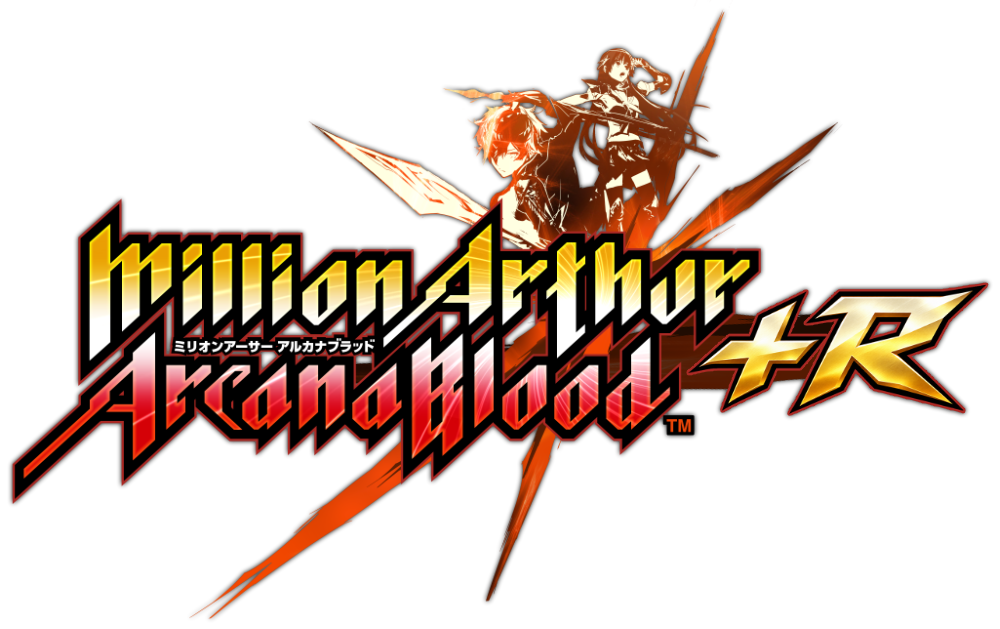

<p align="center">
  
</p>

**Arcana Blood +R** is a fan-made mod for the Steam version of Million Arthur: Arcana Blood. It replaces the game's online play with **rollback netcode**, so online matches feel close to playing side by side.

It also gives the game a new front end: the game starts straight into the mod's own main menu, where you set up your fighter once (character, colour, Support Knights, stage), change controls, sound and display, and find help. A match then starts without going through the game's menus.

The mod is loaded by a small launcher and never changes the game's files. Uninstalling is just deleting the mod's folder.

> **You need the official Steam version of Million Arthur: Arcana Blood to use this mod.**
> The mod does not include the game or any part of it, and it only runs on the Steam version it was made for. It checks the game version at start-up and stays off if it doesn't match.

**No game files in this repository.** There is no art, music, sound or code from the game here. The mod reads the pictures and sounds it shows (menu art, music, menu sounds) from your own installed copy of the game while it runs. The one exception is the logo above, which is based on the game's logo; it belongs to its owners and will be removed on request.

**Version 0.1.0 beta.** This is a beta: problems are expected, and reports help a lot (see "Reporting a problem" below). What changed in each version is in [CHANGELOG.md](CHANGELOG.md).

## Status

- Done: saving and restoring the game state every frame, rollback, online play over Steam (the first internet test, 8 fights, had no desyncs), booting straight into the fight and back.
- The game now boots into our own main menu: My setup (character, colour, Support Knights, stage), Settings (controls for controller and keyboard with a button check, sound, display, online, logs) and Help.
- Next: rooms (Room search / Create room with tables), a clearer connect flow and messages when the other player leaves. Until rooms are done, online matches are started from the F1 overlay.
- The boss character stays hidden for now.

## Using it

1. Put `arcana_launcher.exe`, `arcana_rollback.dll`, `rollback.ini`, `rollback_logo.png` and the `fonts` folder in one folder, anywhere outside the game folder.
2. Start `arcana_launcher.exe`. It finds the game through Steam, starts it, and loads the mod.
3. The game opens on our main menu. To play online for now: press F1, choose "Steam friend", refresh the list, pick your friend and connect.
4. Both players need the same version of the mod. The version is shown in the bottom right of the main menu.

Only the Steam version the mod was made for is supported. If the game version differs, the mod logs this and stays off.

## Reporting a problem

1. In the game: Help > Report a problem > Pack logs. This puts the logs into one zip on your Desktop, with Steam IDs, names and your PC name hidden. Nothing is sent by itself.
2. Open an issue on this repository, say what happened and when, and attach the zip. After a crash or an error message, add a screenshot too.

## Building

The mod and launcher are 32-bit Windows programs built with MinGW-w64. They need no runtimes (no .NET, no Visual C++ redistributable).

```sh
# Ubuntu / WSL
sudo apt install g++-mingw-w64-i686
./build.sh
```

The output goes to `build/` (with `rollback.ini`, the logo and the fonts). The version is set in `src/mod/version.h`.

## Folder layout

| Folder | What is in it |
| --- | --- |
| `src/mod/` | The mod DLL that runs inside the game |
| `src/launcher/` | The launcher that starts the game with the mod |
| `third_party/imgui/` | Dear ImGui 1.82, the UI library |
| `fonts/` | Michroma and Saira Semi Condensed (SIL Open Font License) |
| `assets/` | The logo |
| `config/` | The default `rollback.ini` |
| `docs/` | How the mod works |

## Credits

- GGenie: creator of Arcana Blood +R.
- [Dear ImGui](https://github.com/ocornut/imgui) by Omar Cornut and contributors, MIT licence (`third_party/imgui/LICENSE.txt`), with stb_truetype / stb_rect_pack by Sean Barrett (public domain).
- Fonts: Michroma by Vernon Adams, Saira Semi Condensed by Omnibus-Type, both SIL Open Font License (`fonts/FONTS-LICENSE.txt`).
- Steamworks by Valve, used through the game's own Steam connection.
- GGPO by Tony Cannon: the rollback idea this mod follows.
- The [Mizuumi wiki](https://mizuumi.wiki/w/Million_Arthur:_Arcana_Blood) and the Million Arthur community.
- Million Arthur: Arcana Blood by Square Enix and Team Arcana.

## AI disclaimer

This mod was made with heavy use of AI. Most of the code, the reverse engineering notes and this documentation were written by an AI assistant (Claude, by Anthropic), directed by GGenie, who decided what to build and tested every build in the game. The code has been tested by playing, not by a formal review. Keep that in mind if you build on it, and please report anything that looks wrong.

## Licence

The mod's code is MIT, see `LICENSE`. This is a fan-made mod, not affiliated with or supported by Square Enix or Team Arcana. Million Arthur: Arcana Blood and its logo belong to their owners.
